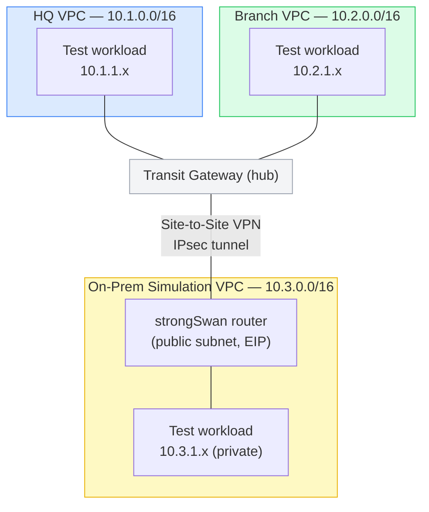

# AWS Hybrid Network Architecture

A multi-VPC AWS network connected through a Transit Gateway hub, with a real
Site-to-Site VPN tunnel simulating secure connectivity to a physical
facility — provisioned entirely in Terraform.

## Why this project

Professionally, I've configured secure tunneling and VPC peering to
establish encrypted communication between government facilities. Most cloud
networking portfolio projects are built from tutorials by people who've
never actually done this kind of work. This one is the opposite: it's a
cloud-native version of a real thing I've done, built to demonstrate the
underlying networking concepts (IPsec, BGP-free static routing, hub-and-spoke
topology, route propagation) rather than just following a guide.

## Architecture



**HQ and Branch** are ordinary spoke VPCs attached to the Transit Gateway —
this is the standard AWS hub-and-spoke pattern for connecting multiple VPCs
without a full mesh of peering connections.

**The On-Prem Simulation VPC** is the interesting part: it isn't attached to
the Transit Gateway directly. Instead, an EC2 instance running strongSwan
acts as an IPsec router — a stand-in for a real on-prem firewall/VPN
appliance — and AWS's Site-to-Site VPN service connects *that* to the
Transit Gateway. This means HQ, Branch, and the simulated on-prem site can
all reach each other through the hub, exactly like a real enterprise network
with a physical location connected back to AWS.

## What's real vs. simplified

Being upfront about the difference between this and a production setup:

- **Only one VPN tunnel is configured** (AWS actually provisions two, for
  redundancy). Configuring both would roughly double the strongSwan setup
  for no additional teaching value in a demo.
- **Static routing, not BGP.** Real enterprise VPNs typically use BGP for
  dynamic route exchange; this uses static routes for simplicity. The
  `aws_customer_gateway` resource still declares a BGP ASN since AWS
  requires one, but it isn't actually used for route exchange here.
- **Single AZ, no HA.** This project is about routing and connectivity
  concepts, not high availability — multi-AZ would add cost without
  demonstrating anything new over the other repos in this portfolio.
- **All traffic between sites is currently unrestricted beyond ICMP/port 80**
  on the test workloads specifically, for connectivity testing. A real
  deployment would scope security groups much further per application.

## Repository Structure

```
├── main.tf                    # Root — wires modules together, defines test workloads
├── variables.tf
├── outputs.tf
├── provider.tf                # AWS provider, S3 backend
├── modules/
│   ├── vpc/                   # Generic VPC module — private subnet always, public subnet optional
│   ├── transit-gateway/       # TGW + spoke VPC attachments + routing
│   ├── vpn/                   # Customer Gateway, TGW-attached VPN connection, strongSwan EC2 router
│   │   └── templates/
│   │       └── strongswan-setup.sh.tftpl
│   └── security-groups/       # Least-privilege SG for test workloads (ICMP + port 80 from other sites only)
└── .github/workflows/
    └── terraform.yml          # Plan-only on push/PR; apply/destroy require manual confirmation
```

## Deployment

This project is **never applied automatically**. Every apply/destroy is a
manual `workflow_dispatch` requiring you to type `go` in the confirmation
field — a lesson learned the expensive way on an earlier project in this
portfolio (see [aws-3tier-terraform-project's postmortem](https://github.com/gkoufie1/aws-3tier-terraform-project/blob/main/docs/POSTMORTEM.md)
for what happens without that safeguard).

```bash
# One-time bootstrap
aws s3api create-bucket --bucket gkoufie-hybrid-network-tfstate --region eu-west-2 \
  --create-bucket-configuration LocationConstraint=eu-west-2
aws s3api put-bucket-versioning --bucket gkoufie-hybrid-network-tfstate \
  --versioning-configuration Status=Enabled

terraform init
terraform apply
```

Or via GitHub Actions: **Actions → Terraform CI/CD → Run workflow**, choose
`apply`, type `go` to confirm.

### Verifying it actually works

Connect to any test instance via SSM (no SSH keys, no open port 22):

```bash
aws ssm start-session --target <instance-id> --region eu-west-2
```

From the HQ or Branch test instance, `curl` the on-prem test instance's
private IP — if the tunnel and routing are working, the request has to
cross: spoke VPC → Transit Gateway → IPsec tunnel → strongSwan router →
on-prem private subnet, and back.

### Tear down

```bash
terraform destroy
```

Or via the same workflow with `destroy` + `go`.

## Cost

Transit Gateway (~$0.05/hr) + VPN connection (~$0.05/hr) + 4 small EC2
instances (~$0.04/hr combined) + an Elastic IP. Roughly **$0.15-0.20/hr**
while running — apply, verify, destroy, not left running.
