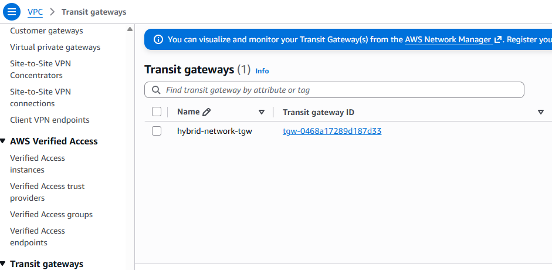
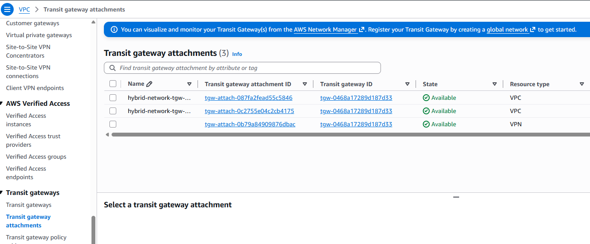
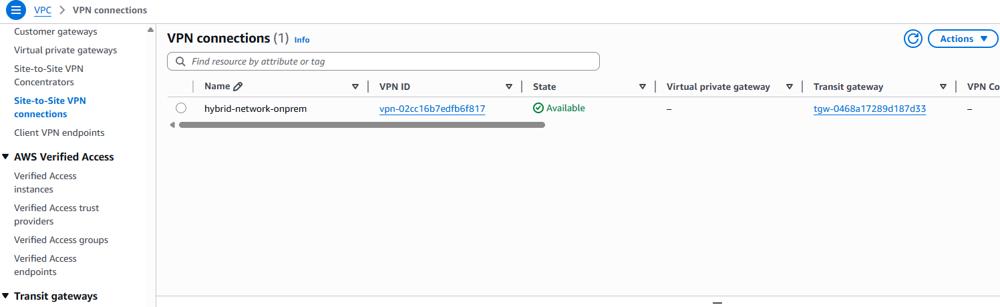
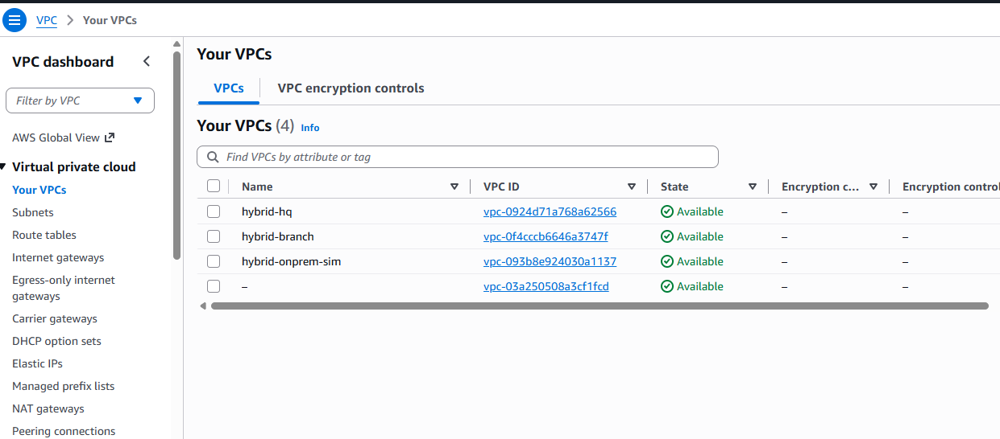
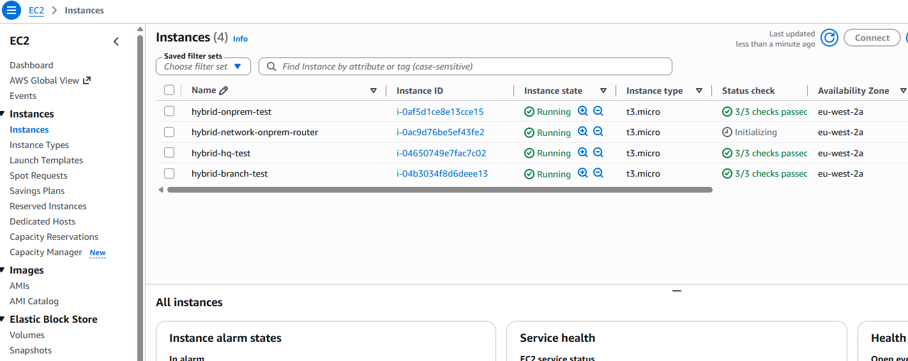
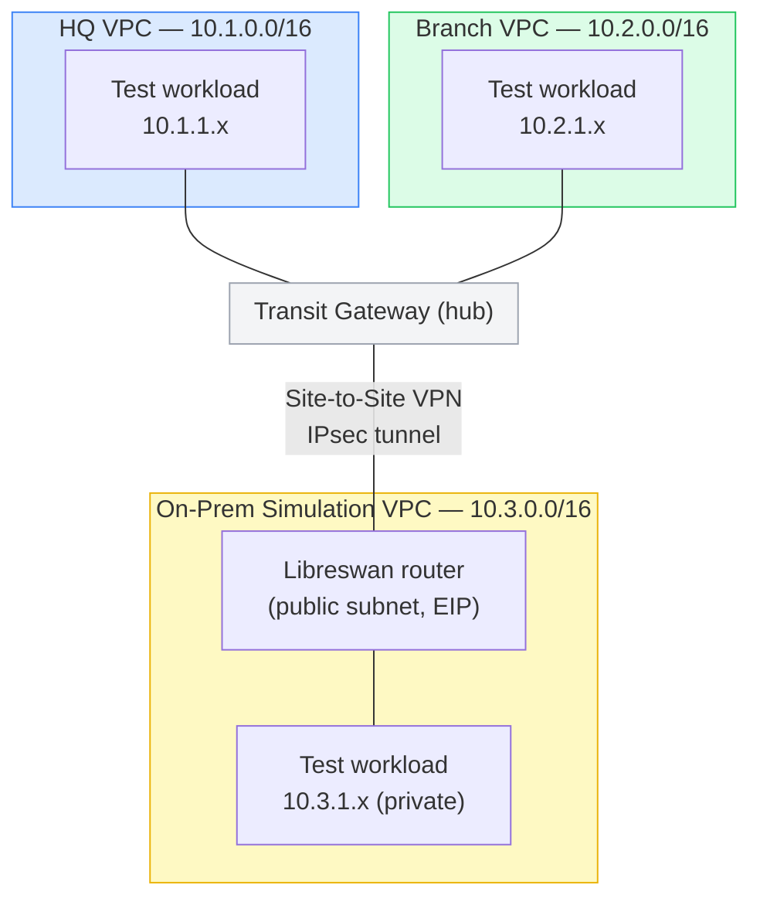

# AWS Hybrid Network Architecture

A multi-VPC AWS network connected through a Transit Gateway hub, with a real
Site-to-Site VPN tunnel simulating secure connectivity to a physical
facility — provisioned entirely in Terraform.

## Why this project

Professionally, I've configured secure tunneling and VPC peering to
establish encrypted communication between government facilities. Most cloud
networking portfolio projects are built from tutorials by people who've
never actually done this kind of work. This one is the opposite: it's a
cloud-native version of a real thing I've done, built to demonstrate the
underlying networking concepts (IPsec, BGP-free static routing, hub-and-spoke
topology, route propagation) rather than just following a guide.

`terraform apply` succeeding on the first try turned out to be nowhere near
the same claim as "the network actually passes traffic." Getting from a
clean apply to a real `ping` succeeding end-to-end, plus a working CI
pipeline, took finding and fixing 9 separate real bugs — see
[docs/POSTMORTEM.md](docs/POSTMORTEM.md) for the full story, including one
caused by Amazon Linux 2023's AMI silently defaulting `iptables`' FORWARD
chain to DROP, and another caused by a GitHub OIDC claim-format change
mid-session that made two byte-identical IAM trust policies behave
differently.

## Verified working

After every fix, this was destroyed completely and reapplied from scratch
— zero manual patching — to confirm the *committed code* works, not just a
live-hotfixed instance. The moment the VPN tunnel came up (entirely from
`user_data`), both spoke VPCs reached the on-prem simulation with 0% packet
loss on the first attempt:

```
=== PING onprem from HQ (fresh deploy, zero manual fixes) ===
PING 10.3.1.21 (10.3.1.21) 56(84) bytes of data.
64 bytes from 10.3.1.21: icmp_seq=1 ttl=125 time=5.21 ms
64 bytes from 10.3.1.21: icmp_seq=2 ttl=125 time=2.01 ms
64 bytes from 10.3.1.21: icmp_seq=3 ttl=125 time=1.85 ms
64 bytes from 10.3.1.21: icmp_seq=4 ttl=125 time=1.85 ms

--- 10.3.1.21 ping statistics ---
4 packets transmitted, 4 received, 0% packet loss, time 3004ms

=== CURL onprem from HQ ===
Hello from ip-10-3-1-21.eu-west-2.compute.internal
```

Branch VPC → on-prem was verified the same way, with the same result.

Console view from that same live test session, before teardown (this
project is destroyed between test sessions to avoid ongoing cost — see
[Deployment](#deployment) — so these reflect a specific run, not an
always-on environment):

| | |
|---|---|
|  |  |
|  |  |
|  | |

## Architecture



**HQ and Branch** are ordinary spoke VPCs attached to the Transit Gateway —
this is the standard AWS hub-and-spoke pattern for connecting multiple VPCs
without a full mesh of peering connections.

**The On-Prem Simulation VPC** is the interesting part: it isn't attached to
the Transit Gateway directly. Instead, an EC2 instance running Libreswan
acts as an IPsec router — a stand-in for a real on-prem firewall/VPN
appliance — and AWS's Site-to-Site VPN service connects *that* to the
Transit Gateway. This means HQ, Branch, and the simulated on-prem site can
all reach each other through the hub, exactly like a real enterprise network
with a physical location connected back to AWS.

## What's real vs. simplified

Being upfront about the difference between this and a production setup:

- **Only one VPN tunnel is configured** (AWS actually provisions two, for
  redundancy). Configuring both would roughly double the Libreswan setup
  for no additional teaching value in a demo.
- **Static routing, not BGP.** Real enterprise VPNs typically use BGP for
  dynamic route exchange; this uses static routes for simplicity. The
  `aws_customer_gateway` resource still declares a BGP ASN since AWS
  requires one, but it isn't actually used for route exchange here.
- **Single AZ, no HA.** This project is about routing and connectivity
  concepts, not high availability — multi-AZ would add cost without
  demonstrating anything new over the other repos in this portfolio.
- **All traffic between sites is currently unrestricted beyond ICMP/port 80**
  on the test workloads specifically, for connectivity testing. A real
  deployment would scope security groups much further per application.

## Repository Structure

```
├── main.tf                    # Root — wires modules together, defines test workloads
├── variables.tf
├── outputs.tf
├── provider.tf                # AWS provider, S3 backend
├── modules/
│   ├── vpc/                   # Generic VPC module — private subnet always, public subnet optional
│   ├── transit-gateway/       # TGW + spoke VPC attachments + routing
│   ├── vpn/                   # Customer Gateway, TGW-attached VPN connection, Libreswan EC2 router
│   │   └── templates/
│   │       └── libreswan-setup.sh.tftpl
│   ├── security-groups/       # Least-privilege SG for test workloads (ICMP + port 80 from other sites only)
│   └── vpc-endpoints/         # PrivateLink to SSM — private subnets have no other path for management
└── .github/workflows/
    └── terraform.yml          # Plan-only on push/PR; apply/destroy require manual confirmation
```

## Deployment

This project is **never applied automatically**. Every apply/destroy is a
manual `workflow_dispatch` requiring you to type `go` in the confirmation
field — a lesson learned the expensive way on an earlier project in this
portfolio (see [aws-3tier-terraform-project's postmortem](https://github.com/gkoufie1/aws-3tier-terraform-project/blob/main/docs/POSTMORTEM.md)
for what happens without that safeguard).

```bash
# One-time bootstrap
aws s3api create-bucket --bucket gkoufie-hybrid-network-tfstate --region eu-west-2 \
  --create-bucket-configuration LocationConstraint=eu-west-2
aws s3api put-bucket-versioning --bucket gkoufie-hybrid-network-tfstate \
  --versioning-configuration Status=Enabled

terraform init
terraform apply
```

Or via GitHub Actions: **Actions → Terraform CI/CD → Run workflow**, choose
`apply`, type `go` to confirm.

### Verifying it actually works

Connect to any test instance via SSM (no SSH keys, no open port 22):

```bash
aws ssm start-session --target <instance-id> --region eu-west-2
```

(This requires the [Session Manager plugin](https://docs.aws.amazon.com/systems-manager/latest/userguide/session-manager-working-with-install-plugin.html)
installed locally. Without it, `aws ssm send-command` with the
`AWS-RunShellScript` document works the same way through pure API calls —
that's how every test in this README and the postmortem was actually run.)

From the HQ or Branch test instance, `curl` the on-prem test instance's
private IP — if the tunnel and routing are working, the request has to
cross: spoke VPC → Transit Gateway → IPsec tunnel → Libreswan router →
on-prem private subnet, and back.

### Tear down

```bash
terraform destroy
```

Or via the same workflow with `destroy` + `go`.

## Cost

Transit Gateway (~$0.05/hr) + VPN connection (~$0.05/hr) + 4 small EC2
instances (~$0.04/hr combined) + 9 VPC interface endpoints for SSM access
(~$0.01/hr each, ~$0.09/hr) + an Elastic IP. Roughly **$0.25-0.30/hr**
while running — apply, verify, destroy, not left running.
